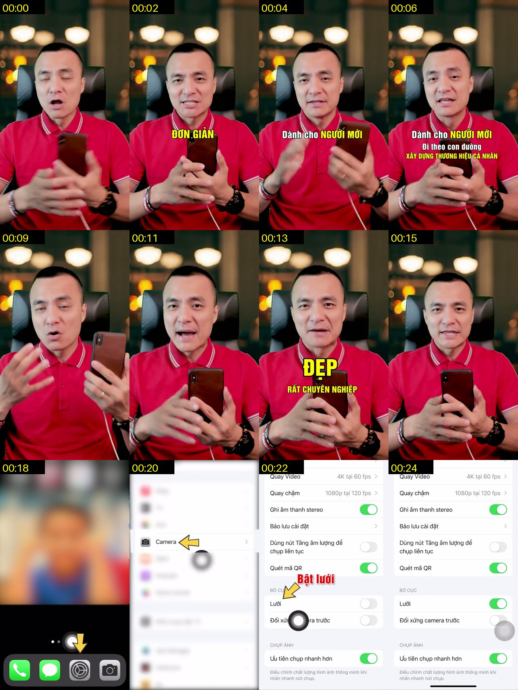
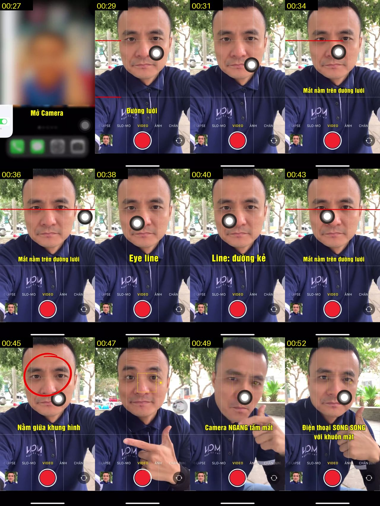
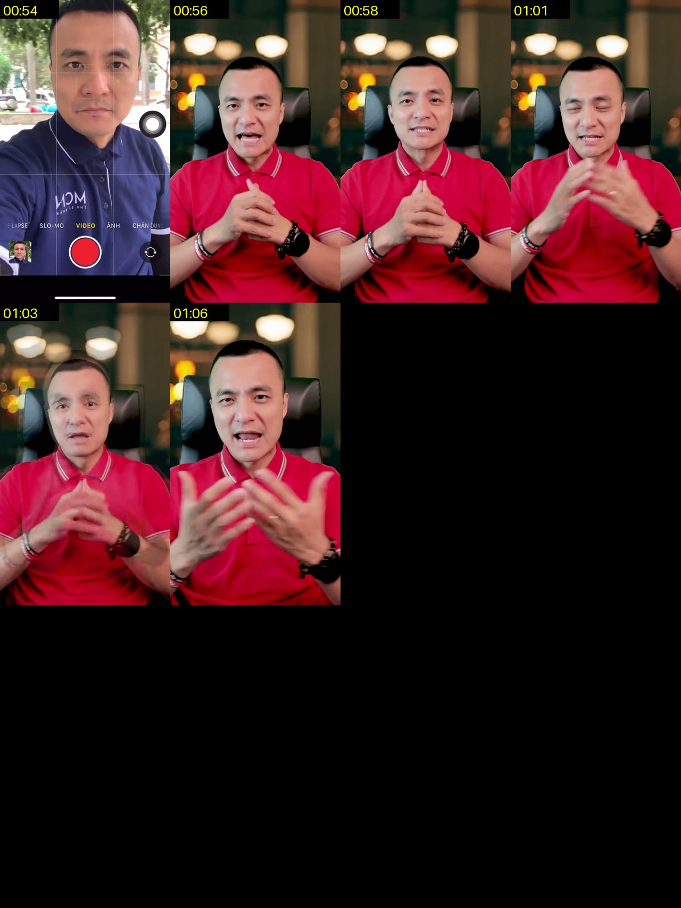

# Báo cáo video TikTok `7184696429867175195`

- **Link:** https://www.tiktok.com/@nguyenanhtung86/video/7184696429867175195
- **Kênh:** @nguyenanhtung86 (Nguyễn Anh Tùng)
- **Thời lượng:** 01:08
- **Lượt xem / thích / bình luận:** 98900 / 2612 / 121
- **Nhạc:** nhạc nền - Nguyễn Anh Tùng
- **Nguồn tải:** yt-dlp  ·  **Xử lý lúc:** 2026-11-24 08:25 UTC

## Mô tả (caption)

Góc máy quay video tiêu chuẩn dành cho người mới làm kênh chuyên gia@Nguyễn Anh Tùng  #LearnOnTikTok #hoccungtiktok #hoclamvideo #huongdan #mcnvn #nguyenanhtung #vitamedia

**Hashtag:** #LearnOnTikTok #hoccungtiktok #hoclamvideo #huongdan #mcnvn #nguyenanhtung #vitamedia

## Lời nói (chép tự động)

_Ngôn ngữ nhận dạng: vi (100%)_

- `[00:00]` Có một động tác quay rất cơ bản, đơn giản sau đây mà dành cho các chị em người mới đi theo con đường xây dựng thương hiệu cá nhân dành cho chuyên gia.
- `[00:08]` Các bạn chỉ cần quay theo đúng bố cục này, video của các bạn tự động đẹp và rất chuyên nghiệp.
- `[00:14]` Cũng mở điện thoại lên và thao tác cùng Nguyễn Anh Tùng.
- `[00:16]` Trước tiên ở trên điện thoại của các bạn, bấm vào ô cài đặt, bấm vào dòng camera, các bạn bật cho mình nút lưới để cho nó hiện màu xanh lên nào.
- `[00:24]` Ok quay ra
- `[00:25]` Mở cam lên nào
- `[00:27]` Và khi mở cam chúng ta sẽ có cái đường lưới
- `[00:29]` Nó sẽ hiện ở màn hình như thế này
- `[00:31]` Và các bạn chỉ cần căn cho mình
- `[00:32]` Cái mắt của mình nó nằm trên cái đường lưới đầu tiên
- `[00:36]` Cái kỹ thuật này gọi là
- `[00:37]` Eye Lye
- `[00:38]` Eye nghĩa là mắt
- `[00:39]` Lye là một đường kẻ
- `[00:41]` Chúng ta chỉ cần mắt của mình nằm đúng trên cái đường kẻ lưới như thế này
- `[00:44]` Và nằm ở giữa khung hình là được
- `[00:46]` Rồi và các bạn chú ý
- `[00:48]` Camera chúng ta sẽ dơ ngang tầm mắt
- `[00:50]` Và điện thoại sẽ song song với gương mặt của mình
- `[00:53]` Các bạn chú ý nhé
- `[00:55]` Vâng chỉ một kỹ thuật rất đơn giản và cơ bản như vậy
- `[00:58]` Các bạn người mới sẽ tự động có cho mình
- `[01:00]` Những thước phim rất chuyên nghiệp
- `[01:02]` Và thu hút người xem
- `[01:03]` Và mình là Nguyễn Anh Tùng
- `[01:05]` Hẹn gặp lại các bạn ở khóa học làm video ngắn

## Chữ trên màn hình (OCR theo khung hình)

- `[00:20]` Camera
- `[00:22]` Eee SAC tS | Quay Video | 4K tai 60 fps | Quay cham | 1080p tai 120 fps | Ghi âm thanh stereo | Bảo lưu cai đặt | Dùng nút Tăng âm lượng để | chụp liên tục | Quét mã QR | Lưới | CHỤP ẢNH | Uu tiên chụp nhanh hơn | Điều chỉnh chất lượng hình ảnh thông minh khi | nhấn nhanh nút chụp.
- `[00:24]` Quay Video | 4K tại 60 fps | Quay chậm | 1080p tại 120 fps | Ghi âm thanh stereo | Bảo lưu cài đặt | Dùng nút Tăng âm lượng để | chụp liên tục | Quét mã QR | BO CỤC | Lưới | Đối xứng camera trước | CHỤP ẢNH | Uu tiên chụp nhanh hơn | Điều chỉnh chất lượng hình ảnh thông minh khi | nhấn nhanh nút chụp.
- `[00:29]` PSE | SLO-MO | ẢNH | CHÂN | Sad)
- `[00:31]` PSE | SLO-MO | ANH | CHAN
- `[00:34]` Pye | PSE | SLO-MO | ANH | CHAN
- `[00:36]` a we | 2 ae | PSE | SLO-MO | ANH | CHAN:
- `[00:38]` TA fe | wit | PSE | SLO-MO | ANH | CHAN
- `[00:40]` ee Bl’ | a ae | PSE | SLO-MO | ANH | CHAN
- `[00:43]` Ñ Nạ | PSE | SLO-MO | CHAN | ANH
- `[00:45]` ñ Nạ | PSE | SLO-MO | ANH | CHAN
- `[00:47]` wed | PSE | O-MO
- `[00:49]` LAPSE SLO-MO
- `[00:52]` ste | LAPSE | SLO-MO | CHAN D
- `[00:54]` PLE | PSE | SLO-MO | ANH | CHAN Du)

## Ảnh tổng hợp khung hình

Tổng 30 khung hình trong thư mục `frames/`.
