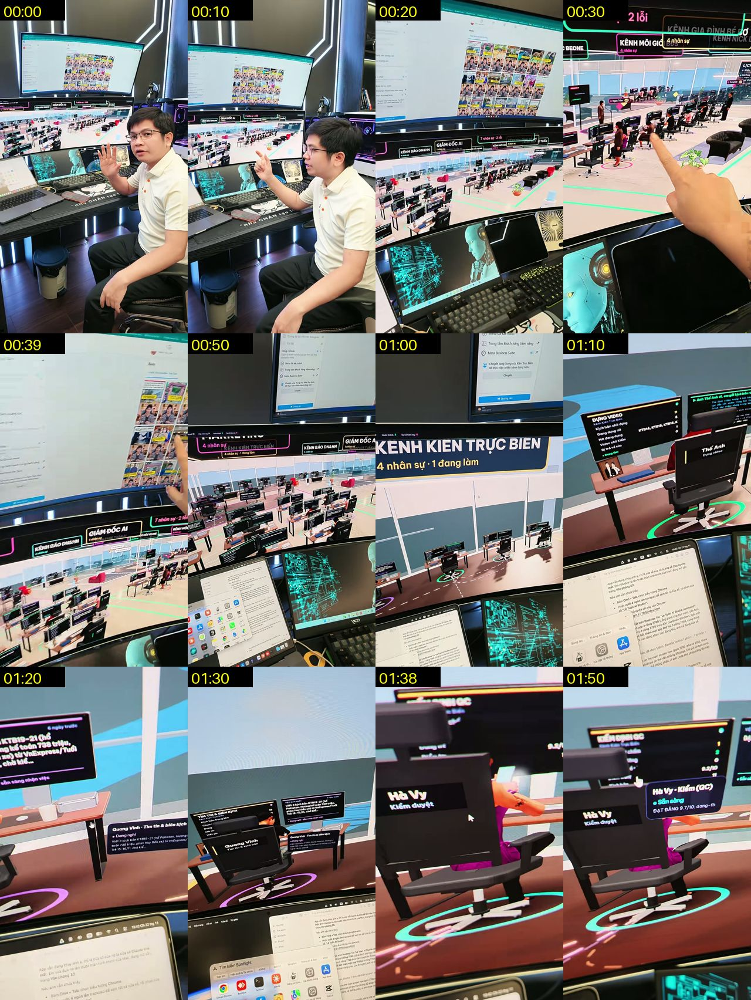
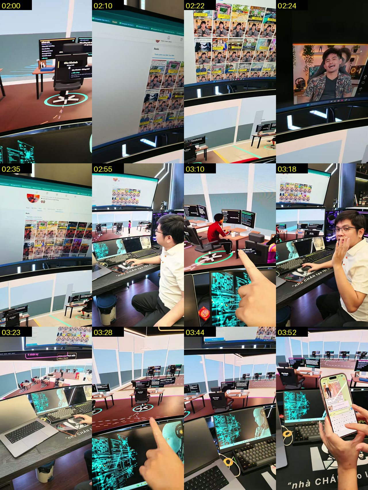
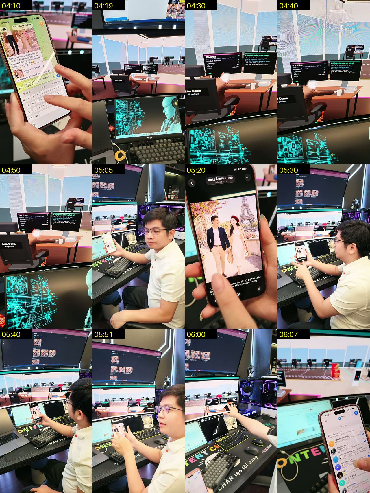
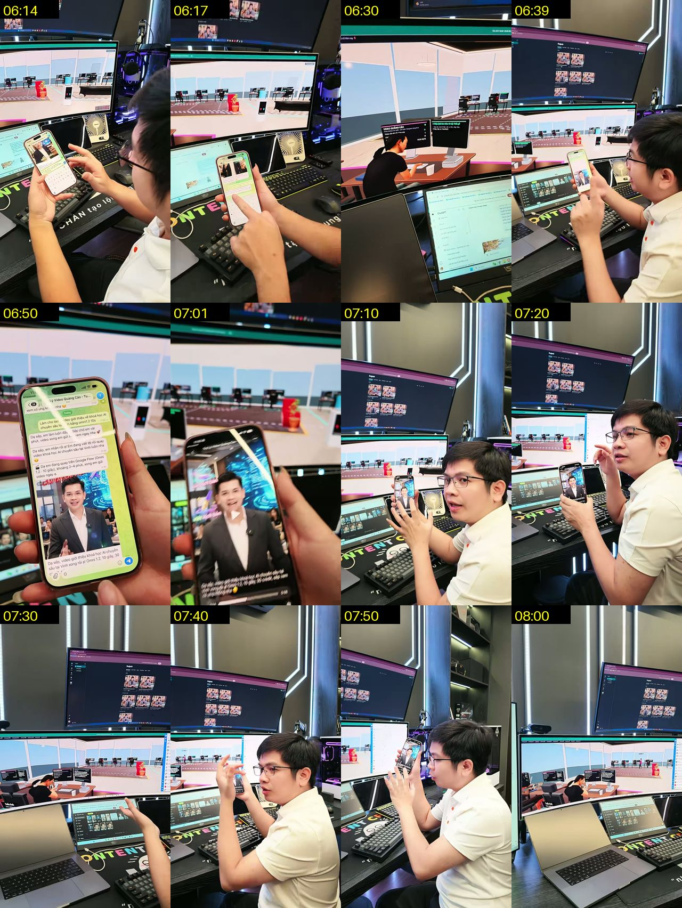

# Báo cáo video TikTok `7711318837890714900`

- **Link:** https://vt.tiktok.com/ZSsF5bkrg/
- **Kênh:** @nganthomvlog (Ngân Thơm Shop)
- **Thời lượng:** 08:10
- **Lượt xem / thích / bình luận:** 101900 / 1635 / 128
- **Nhạc:** âm thanh gốc - Ngân Thơm Shop
- **Nguồn tải:** yt-dlp  ·  **Xử lý lúc:** 2026-11-24 08:32 UTC

## Mô tả (caption)

Ây ai đang giúp chúng ta làm được những gì ? 🤔

## Lời nói (chép tự động)

_Ngôn ngữ nhận dạng: vi (100%)_

- `[00:00]` Chào cả nhà, cả nhà hãy hỏi Tuấn là bây giờ AI nó giúp ích được gì cho mình trong cái công việc kinh doanh và bản hàng trên mạng thì hôm nay Tuấn sẽ cho cả nhà thấy được cái AI nó đã dùng như thế nào nhé. Đây, đây cả nhà như thế này. Đây là toàn bộ các cái nhân viên AI của Tuấn. Tuấn tạo ra cái văn phòng nhân viên AI này để nó làm việc hỗ trợ Tuấn các cái công việc trên mạng hiện tại. Mỗi ban, mỗi cái góc này là sẽ có một đồi nhóm nhân viên để phụ trách từng cái công việc một nha cả nhà nhé.
- `[00:26]` ví dụ như đồi này đồi bên này sẽ phụ trách cái vấn đề là chăm sóc tư vấn khách hàng tự động ở trên
- `[00:33]` gia lỗ hay là có những cái đồi là mỗi đồi sẽ phụ trách một cái cánh Facebook ví dụ như đây là một cái
- `[00:40]` cánh fanpage mà Tuấn mới tạo ra này cả nhà này đây là cánh về tin tức thì ở trên văn phòng này sẽ
- `[00:48]` có một đồi chuyên chuyên phụ trách về cái cánh đó cho cả nhà xem nha đây đây mọi người thấy không
- `[00:57]` Cái cánh nó phụ trách là ở trên đây này
- `[00:59]` Đó, kiến trực biển là cái cánh này Tuấn đang làm này
- `[01:02]` Đó, bên dưới sẽ có 4 nhân viên phụ trách đây
- `[01:04]` Đây là cái anh nhân viên đầu tiên đây
- `[01:07]` Đây là cái anh nhân viên đầu tiên
- `[01:10]` Anh này sẽ, hàng ngày là sẽ đi tìm các cái team tức họt
- `[01:17]` Đó, đi tìm các cái team tức họt
- `[01:19]` Đây, cả nhà nhìn trên màn hình của nó là cùng
- `[01:21]` Trên màn hình của nhân viên là sẽ có các cái bài hôm nay bà đã đang làm, đang tìm
- `[01:26]` Đó, sau khi bà này tìm tìm được ok
- `[01:28]` Tìm được cả cái tin hỏi tin hái rồi
- `[01:30]` Bạn sẽ chuyển qua cho cái bàn thể ánh
- `[01:32]` Bàn ấy là bàn chuyên full track về quay dừng
- `[01:35]` Bạn sẽ dừng
- `[01:36]` Từ cái kịch bản đó bạn sẽ dừng thanh video nha
- `[01:39]` Đây trên màn hình bạn đang làm việc đây
- `[01:41]` Các bạn thấy không
- `[01:42]` Trên màn hình đang làm việc đây
- `[01:44]` Sau khi bạn này dừng video sống
- `[01:46]` Thì bạn sẽ chuyển qua cho bàn ha ví
- `[01:48]` Bàn ha ví này sẽ kiểm lại cái video
- `[01:50]` Xem video có ok hay không
- `[01:52]` Đã chuẩn hay chưa
- `[01:53]` Mặt mùi ok hay không
- `[01:54]` Tất cả mọi thứ minh hòa ok rồi
- `[01:57]` Thì bạn sẽ chuyển qua cho bạn giá khảnh một bên này
- `[01:59]` Bạn này sẽ đăng bài lên trên phần bể luôn cả nhà nha
- `[02:02]` Sau khi bạn nhận được cái bài từ bàn ha ví đã kiểm ok rồi
- `[02:08]` Thì bạn sẽ đăng lên bể từ đồng luôn
- `[02:09]` Tức là tất cả các cái khấu này là từ đồng, từ á đến dẹt luôn
- `[02:12]` Từ việc tìm tiến, việc kịch bản, từ việc dừng video, kiểm đình video
- `[02:16]` Và đăng bài là từ đồng cả nhà cả nhà nha
- `[02:19]` Và những cái video đây
- `[02:21]` Rất rộng người thật
- `[02:22]` Đây, rất rộng người thật nói chuyện nhà cả nhà nha
- `[02:25]` Ý đúc không khác gì cả
- `[02:26]` Nhiều người nhìn vào sẽ không biết đấy là AI đâu
- `[02:30]` Nhưng mà đó là AI nói đó cả nhà nha
- `[02:31]` AI nói AI giới thiệu
- `[02:33]` AI đưa tin
- `[02:35]` Và cái cánh hoàn toàn từ đầu
- `[02:37]` Từ A điểm diện luôn
- `[02:38]` Các bạn đã từ làm việc cho Tuấn là không biết
- `[02:40]` Các bạn đang đăng cái gì luôn
- `[02:41]` Tuấn chỉ set up lúc đầu thôi
- `[02:43]` Chỉ set up lúc đầu là cái cánh này
- `[02:44]` Sẽ làm về cái chủ đề gì
- `[02:46]` Video như thế nào
- `[02:47]` Thì Tuấn sẽ set up lúc đầu
- `[02:49]` Sau đó cánh nó từ hoạt động
- `[02:50]` Các bạn này đã
- `[02:52]` Ý như các bạn nhân viên đang làm việc ở ngoài nha
- `[02:54]` Cả nhà nha
- `[02:55]` Bạn nào mà không làm việc
- `[02:56]` Thì mình sẽ cho các bạn ngồi chơi điện thoại đây
- `[03:00]` Đây, ví dụ như bạn ra khảnh đáng không làm việc
- `[03:02]` Thì bạn ngồi chơi điện thoại, ngồi lượt điện thoại
- `[03:04]` Đó
- `[03:05]` Tức là bạn chưa có bay để đắng
- `[03:07]` Hoặc là bạn đang bay xong rồi
- `[03:09]` Còn bạn này đang dừng video cho nên bạn đang gò mấy tĩnh nha cả nhà nha
- `[03:12]` Bạn này đang dừng video nha
- `[03:14]` Bạn này đang dừng video
- `[03:15]` Đó, bạn này thì tin tín xong rồi
- `[03:17]` Ok đó nha
- `[03:18]` Tất cả các bạn này đều có thể nhận lệnh từ điện thoại trực tiếp được
- `[03:21]` Ví dụ như cho các nhà xem một cái bàn này
- `[03:23]` Bàn ký mũ anh này
- `[03:26]` mình có cái bàn bàn kím ảnh này đây ở đây bàn kím ảnh này là bàn chuyên phụ trách với ảnh
- `[03:31]` nha các nhà nha bạn đã về ảnh làm ảnh rất là đẹp bạn đã có hàng trăm cái skill ở trong đầu bàn
- `[03:36]` đó rồi thì bây giờ nếu mà mình muốn ra lành cho cái bàn này làm cho mình một bức ảnh đẹp mình
- `[03:43]` chỉ cần cầm điện thoại lên nha các nhà nha này chỉ cần cầm điện thoại lên vào telegram vào nick
- `[03:49]` bạn trợ lý ảnh kiếm ảnh nha. Ví dụ như mình chỉ cần nhận là làm cho tao. Một bức ảnh đang đi du lịch
- `[04:05]` bên cung vợ. Đây nhắn tin nha. Nhắn tin. Đó. Lập tức trên màn hình của bạn nhân viên nó sẽ hiển
- `[04:18]` sẽ nhận được lệnh. Trên màn hình bạn đó sẽ nhận được lệnh gửi từ telegram quá và bạn đó sẽ tự động làm việc, tự động làm ảnh. Bây giờ bạn đó sẽ vào GPT để làm ảnh. Bình thường là mọi người sẽ phải từ thủ cống, mọi người phải ngồi vào máy tĩnh, mọi người phải gò, mọi người phải bật GPT lên nhập câu lệnh, nhập hình ảnh vào để làm việc.
- `[04:42]` Còn bây giờ Tuấn đã tạo cho mọi người một cái con AI để có thể làm ảnh được thấy cho mình
- `[04:48]` Bà này sẽ luôn luôn ngồi trên mấy tỉnh trực tin nhắn
- `[04:52]` Khi nào mình ra lành thì bà này sẽ vào GPT để làm ảnh
- `[04:56]` Sau khi làm xong sẽ gửi qua điện thoại cho mọi người
- `[04:58]` Mọi người cũng cần phải tạo tạc gì cả, chỉ cần ra lành thôi
- `[05:00]` Đi chơi, đi nhở, đi du lịch, tự nhiên cứ đi bình thường
- `[05:03]` Bà này sẽ ở nhà làm việc cho mọi người
- `[05:05]` Nó làm mình ra lành cho nó xong nó chơi nó vài ba phút nó bảo là em nhận rồi xếp chơi em chút xịu
- `[05:13]` ảnh xong em gửi liền đó thì sau khi bà đã làm ảnh xong thì bà đã gửi đấy. Cả nhà thấy không?
- `[05:19]` Mình bảo bà đã làm ảnh vợ chồng mình đang đi du lịch ở bên Pháp một người thể dẫu đẹp á.
- `[05:24]` Vì bà đã đã có tất cả những skill ảnh đẹp ở trong đâu rồi cho nên là khi bà bà làm ảnh là bà làm ảnh đẹp luôn.
- `[05:30]` Chứ không cần mọi người phải từ đi gò câu lành lên trên GPT để làm ảnh nữa đâu nha.
- `[05:35]` Vì nhiều bạn là không biết dùng câu lệnh cho nên là làm ảnh trên GPT nó rất là xấu
- `[05:39]` Rồi ví dụ như đây là làm ảnh nha cả nhà nha
- `[05:42]` Mọi người có thấy tiến không? AI là nó giúp mình như vậy
- `[05:45]` Mình cũng cần phải ngồi ở May Tịnh cả ngay
- `[05:48]` AI là giúp mình tự động họa trong cái công việc
- `[05:51]` Đấy là nhân viên làm ảnh
- `[05:52]` Nhưng mà ở trong này là có rất là nhiều nhân viên
- `[05:55]` Cũng có những cái bàn nhân viên làm video nhánh nha cả nhà nha
- `[05:58]` Ở đây
- `[05:58]` Mọi người nhìn này bên phải đây
- `[06:00]` Có một bàn này
- `[06:01]` Bàn này là bàn nhân viên làm video
- `[06:03]` làm video thì ví dụ như mọi người muốn làm video gì thì cũng nhận tin giống như bạn lắm ảnh nha
- `[06:07]` bàn đó là bàn quản bản trợ lý làm video quảng cáo đó thì bây giờ mình sẽ nhận cho bạn là làm cho
- `[06:13]` mình một video nha đây mình ra là như thế này nhá cả nhá mình ra lệnh này nó ra sẽ em làm luôn đấy
- `[06:19]` sẽ chơi em vai phút đây mày mới nghe nhìn ở trên màn hình của nhân viên nó sẽ hiền lên là đà nhận
- `[06:26]` lành tư sệp tuận gửi thì nó nhận lành thì nó sẽ không chơi điện thoại nữa nó sẽ bắt đầu làm việc
- `[06:31]` để nhìn cái dòng lành nó bắt đầu làm việc nha cả nhà nha Nó làm việc sóng này nó bảo là đà sóng đã
- `[06:42]` gửi video cho xịt đây nha cả nhà nha đây cả nhà nhìn này đó đây trên điện thoại đấy nó đã gửi
- `[06:49]` video qua bên điện thoại luôn nha cả nhà nha đây học thật làm thật cầm tay chỉ việc viết kịch bản
- `[06:56]` làm ảnh làm video bằng ai bạn muốn làm chủ ai cùng Tuấn không nhắn Tuấn đăng ký ngay nhá cả nhà
- `[07:02]` cả nhà thầy tiền đó tất cả nhân viên ở đây đều có thể nhận lệnh trực tiếp của mình để làm việc ngay
- `[07:07]` theo mình và gửi gửi kết quả cho mình quá điện thoại và cũng có những nhân viên là làm việc theo
- `[07:13]` lịch tự động mình có thể cài sản là thằng này mày buổi sáng 7 giờ 17 giờ là mày cứ phải đi tím những
- `[07:21]` cái tin mở cho tao tìm những kịch bản mở cho tao rồi chuyển qua thằng quay rừng thằng quay rừng dừng
- `[07:25]` xong video chuyển qua cho thằng kiểm thằng kiểm kiểm sóng thì chuyển qua cho thằng đắng và nó cứ tự
- `[07:31]` đồng làm việc như vậy hằng ngày cho cả nhà nó tự đồng làm việc hằng ngày nó từ dừng video nó tự
- `[07:36]` mà mình không cần phải làm gì cả
- `[07:37]` mình bắt chật mình muốn làm video này
- `[07:40]` bắt chật mình muốn làm cái ảnh này
- `[07:42]` thì mình có thể nhận tin trực tiếp cho nó
- `[07:44]` và nó làm cho mình, nó gửi qua điện thoại cho mình
- `[07:46]` đó là cái tiền của AI nha
- `[07:47]` cái tiền của AI là như vậy
- `[07:49]` mình không cần phải ngồi trực tiếp ở mây tĩnh này
- `[07:51]` để mình gò lành, gò phím, gò câu lành
- `[07:54]` để làm ảnh, làm video nữa
- `[07:55]` mà bây giờ nó tự động hoàn toàn như vậy đấy
- `[07:57]` đó là những cái gì mà
- `[08:00]` Bến Tuấn đang hướng dẫn
- `[08:01]` cho những bạn học viên để
- `[08:03]` áp dụng AI vào trong công việc là như vậy
- `[08:05]` Các nhà ai mà muốn tư vận với ai thì alo cho bên tuần thớm nha

Phụ đề gốc của TikTok: [sub.vie-VN.vtt](sub.vie-VN.vtt)

## Chữ trên màn hình (OCR theo khung hình)

- `[00:00]` [siwsfem | 2 2Ì | ica
- `[00:10]` FES ay | sát | lgúwpốem. | ere gate — | sin | wre | ae ft | ES se
- `[00:20]` Pay | peed 0/100
- `[00:30]` nhôn sự - 2 lỗi | nhôn sự | Bhd | ime
- `[00:39]` iTS | 7 nhân 9 “2 | ciám Đốc AI | age! | eas [I
- `[00:50]` in thác | mm "unuSế | GIÁM ĐỐC A | 4 nhên SI | TnhộnỰ, | stay | KENH BÁO: DN&HN | obs | a đã XE | ass
- `[01:00]` rung tâm khách hàng tiềm năng _ 7 | ) Meta Business Suite | “Chuyến sang Trang của Kiên Trự Biến | để thực hiện nhiều hành động hơn | Chuyến | Svefhemey 6 | KENH KIEN TRỰC BIEN | 4 nhan sự - 1 đang làm | oom
- `[01:10]` trực | tiến | pan oh | yen! | cro | and | dựng | moe | enn | iu về | pn too | 22S | ‘phon | vuốt | 1 4 098 | võ TUỂn | quan | 718% | Ys 20 | 711 | apo | san
- `[01:20]` sang chượn vite | Quang Vinh | - Tìm tin & biên kich | e Dang nghỉ | Teto-21 (hổ Pokis | tan. Hương. | Viết 3 kịch bank | u, phim | Huy Bến xe) tử | VnExpre32/ | Trẻ 16-16/11. | toán 738 triê | hờ kid. | = ơ220611 | soo
- `[01:30]` vế ormmer | Km ean | feoan 728. | trator | VN nh renee | ven | an abnor | ons | Sree | vinh - Tintin & ankle | ong ooh | omen ĐỀ | oun | mg BÁU | 230. | end +10. | ám spotlight | xan | suất TẾ Cứ | rit | nếu | reine
- `[01:38]` west | wany | vvêca duyệt.
- `[01:50]` e sẵn sàng | wavy | Đạt ĐĂNG 9.7/10:4008 “7 | Kien đuyệt.
- `[02:00]` Gia Khánh | Đăng bet | Can Khánh- Đăng ht | «săn zing. | ay đang bồi EB HEN GỖ ED | gran Foceboot
- `[02:10]` ioe
- `[02:22]` heal | "xen | giới ^ | fat | Cel ee
- `[02:24]` ier | Ais | faut | iis | hal | had. | Tey
- `[02:35]` rae | Aah ye
- `[02:55]` y TF | L 64
- `[03:10]` (ri vo nến | Long 0000 | —wSS
- `[03:18]` SS S2 | BAL | es Se | a aera | ÖÔÒ “2E | navy | SST
- `[03:23]` nhãn | esses | GAA
- `[03:28]` mực rót | Faq | 242
- `[03:44]` YamOanh | partes
- `[03:52]` “nhà CHA!
- `[04:10]` Ao:aSÀ® | nar) | TiS Wy ANN | LVS | on SEP | y dat | cent | jan9, | yore | Not | pat | 2A6A\999 | 19512 | eno | ede? | sốc | 4000) | 2y 92 | 0 20 | vàn oh
- `[04:19]` la ke | mores | athe | ate | Nay DP | Lal | a BS
- `[04:30]` i Le | > Nhộn lệnh làm ảnh tử sếp Tuấn gửi | Tow dn và bằng CheAGPT web (gi đơn 7), Oem | > la lấy chs Yah lần trước làn te | Ảnh đã gửi sếp hôm noy | © dây lệ: Tao cho lộn Íh Phí tử thần cổ | 9 đc tập tưe-ea-đÍ-ol-y.trt | Lệnh Telegr” ` | .9 Giy ph: Vẽ deh blag het và gửi Tedegr | » big về bù Cutt và pit sp. | ‘Téng at | tin62//1 | cies | Kam Oanh | og si anh | Ibs
- `[04:40]` WOA SĨ ANH | ‘> Nhận lịnh lim ảnh từ sếp Tuổn gửi | » bag lấy ch If lần tate làm thỏa. | ooo av bằng Chana we | oth eng et) xm | 9 đc tp tue-Đex-d[clol., | nh đã gử sếphôm ney | » bang vẽ Og CAPT và 9 | hPa tờ tên cố | Lệnh Tele” | hy fa: VE deh beg Cat và gi Telegr | “Tổng ð" | nea | ong | \Oanh | sa st anh
- `[04:50]` all | NONSIANH | Merv ng Che wu (gi ong) Out | Nga fa lam ảnh tử sếp Tuấn git | ly ch a he tưc làn a. | aes | Ảnh giả vấphôm nay | ar Hi: | Là PM tờ tad 8 | "LẠnh TRhsgr. | 9 ey Ib | toa | at tà gi rele | "Tên ier | ous | sie 21/11 | im Sanh | Mog stan
- `[05:05]` ARE
- `[05:20]` wre | eee | Anh | Kim Oanh | today | lrŸ | ete | sat | Gee | hye | đới | mlòm 6 | với eh | ó UNO | ip xo
- `[05:30]` mài | cee | ans
- `[05:40]` SSS | st 4 | se esese
- `[06:00]` PES Ess | các | BIE | Emad | AP ay | ee ty | a ay | Lag
- `[06:07]` 10:89 | chats | you" | pen’ | avin | pio | geo™ | eon’ | ott?
- `[06:14]` UE IS ft | NEEEEEEE==m | ale | [lal | Brea ir | aby
- `[06:17]` krssneeuieng | AoiMauue) | a eS ja | hie | eal | cle | =the | f 57 | iiss
- `[06:30]` jedriennay 6 | ‘alo mae at | Pieper | nan | Lời
- `[06:39]` sae | Gn aes | a oS | s45. | 083
- `[06:50]` we a | Wor | 'Video Quảng © | nna | xem cout | ng kt | giới thiệu | vệ khoá học Al | deo | 40s | Làm cho tao. | bằng omni! | chuyên sauté | ép chỉ | em vai | sếp, el | m làm | yuan đây | em n4 | gay nha 5” | Das | gus | phút, vi | deo xong em | viết ti rồi BUY | n đang ¥ | won nha. | ema | nan rồi 3! | n sâu tal | Vint | Dạ SẾP. | học | A\ chuYÊ" | video kh\ | le Flow | 1g quê) | y wen | m gửi | Dạ em đãi | oang 2“ | út, XOn9 EI | video ngaY 3 | coy 4 | Fes | wage | aye | nod | 2,10 | ogiới thỆ | omni | rồi | sn xong.
- `[07:01]` a ee | be J | Lait | WT dys | 71/7724 an | Mean Wy Ta | yes 274
- `[07:10]` nee | q4 1
- `[07:20]` mm mm | Vess866g- | cod
- `[07:30]` Hae es | mt 5 I | pak
- `[07:40]` Bae | eon | bào)
- `[07:50]` chưng | rZ“ TP
- `[08:00]` eae! | Ss] eT | ary | Sle,

## Ảnh tổng hợp khung hình

Tổng 48 khung hình trong thư mục `frames/`.
